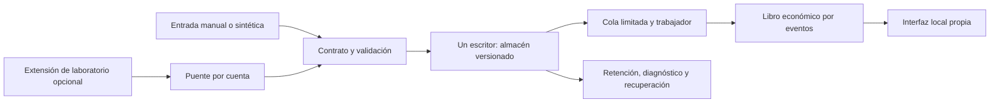

# Arquitectura y decisiones

La edición manual incluye M, V, S, W, E, U y P. L y B están ausentes de su paquete. Grafana queda como integración opcional futura, sin credenciales de escritura ni acceso a respuestas generales privadas; no se añade por continuidad con el legado.

## Decisiones registradas

| Decisión | Necesidad / evidencia | Coste y límite |
|---|---|---|
| Separar una preliminar manual del legado | Procedencia incierta de captura/assets; no hay decisión de Origin sobre la nueva versión | Menor paridad funcional. Se preserva el trabajo anterior para reutilizar aportaciones propias tras revisión |
| Contrato cerrado y calidad por hecho | Evitar ceros ficticios, mezcla de cuentas y frescura falsa | Más metadatos por captura; tamaño acotado y rechazo explícito |
| Hash sin fechas, con calidad/origen | La huella anterior incluye la fecha; benchmark de diez estados en 1.000 observaciones | La fecha se conserva aparte; no se borra evidencia temporal |
| Captura explícita por gesto, documento visible | Reducir privilegios/tráfico y facilitar revisión del alcance | No ofrece autoescaneo completo. El DOM real y formatos regionales siguen pendientes |
| Coordinación en service worker por cuenta/cuerpo | Evitar cachés duplicadas por pestaña | Cache de 64 claves, ocho pendientes y ventana de renovación de cinco minutos; suspensión de MV3 exige reintento explícito |
| Capturas completas acotadas, sin deltas | Diez envíos en la ráfaga sintética ya reducen duplicación | No se justifica aún negociar bases/versiones, tombstones y reparación de deltas |
| Reintento local progresivo | Servidor local puede estar detenido | Como máximo tres intentos con jitter y timeout, nunca contra OGame; 401/403 se detienen |
| Almacén de un escritor y CAS | Evitar actualizaciones perdidas y procesos simultáneos | No es una base multiusuario; un segundo proceso se rechaza |
| Integración económica por eventos | Trabajar con costes y tasas explícitos sin trasladar el catálogo anterior | Ganancias/duraciones manuales y recursos centralizados; sin física de juego ni transporte |
| Worker y límites | No acoplar cálculos al servidor HTTP | Un worker, ocho trabajos, timeout 1,5 s y heap V8 64 MiB; límites nativos/OS requieren prueba de contenedor |
| Paquete por lista positiva | Acceso parcial real, sin código restringido oculto | Cada función adicional exige revisar y reconstruir el manifiesto de entrega |

## Escrituras y recuperación

El servidor usa un bloqueo `wx` durante la vida del escritor, cola de promesas y escritura de temporal con fsync seguido de rename. Cada estado contiene checksum, versión y revisión. Las revisiones de cuenta permiten detectar un `If-Match` obsoleto. Los campos se fusionan por fecha y calidad para que actualizaciones de planetas distintos no se pierdan.

Un cambio de datos invalida la caché del trabajador solo por los datos que se vuelven a enviar; el trabajador no conserva sesiones ni credenciales y no hereda entorno/argumentos del proceso principal. La cola no es un mecanismo de ejecución de órdenes del juego: solo calcula hipótesis.

El borrado invalida primero las sesiones/puentes y la época de las peticiones, después se serializa con el almacén. Capturas con cuerpo pendiente y resultados analíticos empezados antes se rechazan al finalizar. La extensión cancela su cola/ACK y aborta el envío pendiente antes de olvidar credenciales. Los datos ya entregados al servidor requieren el borrado del servidor; desconectar el cliente no finge borrarlos.

La copia `.bak` conserva el estado anterior validado con retención aplicada. Daños del principal permiten recuperar esa copia, preservando el archivo dañado. Se puede perder la última transacción: se comunica como recuperación, no como conservación perfecta. Si ambos son ilegibles se falla cerrado. La migración interna v1 conserva `.v1`; no es la misma operación que convertir un export del legado.

## Fronteras de seguridad

Arranque manual: 127.0.0.1:3176; ninguna red exterior del producto. Sesión de panel HttpOnly y SameSite, secretos nunca en URLs o respuestas generales. Laboratorio opcional: invitaciones de un uso con ID de extensión y cuenta exactos, token de escritura sin lectura y revocación. Nada requiere un servidor central, identificador de dispositivo o activación remota.

El candidato de Docker utiliza entrada separada: escucha en la red privada del contenedor y admite solo el gateway configurado o loopback, con Host/Origin del puerto local. No está incluido ni validado como despliegue. La frontera de IP, subred, ACL/volumen, digest y límites requiere ensayos antes de autorizar su uso.

## Medición e independencia

`../research/reports/benchmark.json` registra condiciones y resultados. La reducción de envíos se aplica a un ensayo semántico sintético. La comparación de la sonda HTTP usa el mismo motor nuevo acoplado y en worker; no atribuye una mejora universal frente al motor anterior. Costes operativos reales, consumo estable, escenarios de larga duración y fórmulas del juego necesitan otros ensayos.

No se llama clean room a este desarrollo. Se había leído código previo; se documentan requisitos, decisiones y coincidencias para revisión posterior. Separar procesos, cambiar APIs o usar otros nombres no confiere derechos ni tolerancia.
