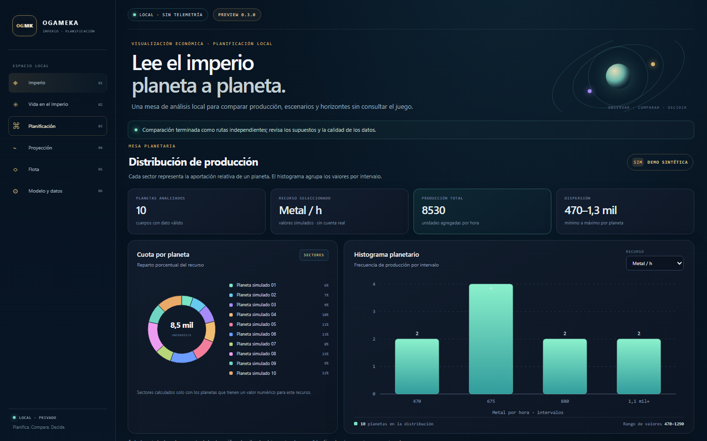
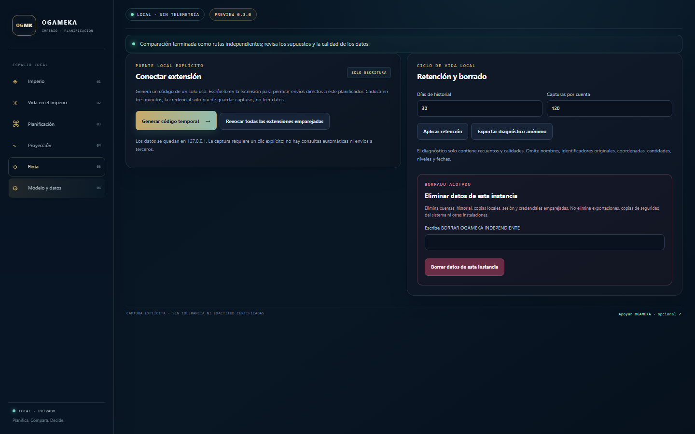
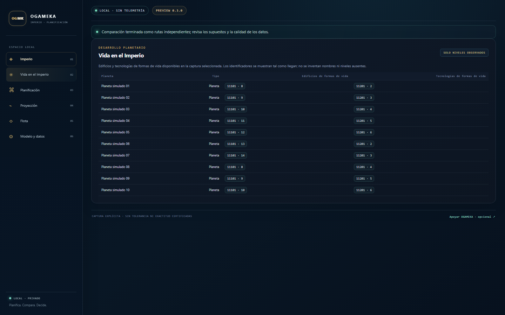
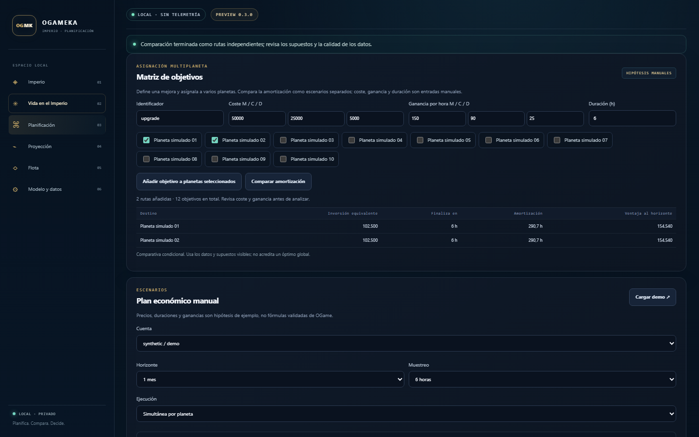

# OGAMEKA Local Planner

**A local-first OGame economy viewer and scenario planner.** The browser extension reads selected values from the page you opened after an explicit click, then sends the validated capture to the planner running on your computer.

> **Pre-release 0.3.0.** This extension has not been declared tolerated by Origin. Do not capture a live OGame account unless Origin lists this exact version as tolerated. OGAMEKA is unofficial; this release does not establish approval, legal permission from Gameforge, or validation of game formulas.

**Español:** [guía en español](#español) · **English:** [overview and setup](#english)

## Screenshots

Screenshots use the built-in synthetic scenario. They contain no player or account data.









## English

### What it does

- Shows production shares, histograms, and a per-planet production table across multiple planets.
- Includes dedicated Empire, Life in the Empire, Planning, Projection, Fleet boundary, and Model and Data views.
- The planning matrix can compare a manually defined objective on selected planets as separate conditional amortization routes, or add those routes to a scenario.
- Compares small, user-defined economic scenarios over 1, 3 or 6 months and displays conditional projections and event timelines.
- Includes a Manifest V3 browser extension with an explicit, one-click visible-page capture.
- Sends a capture only to the local planner at `127.0.0.1:3176`, after one-time pairing and the user's click. The extension credential can upload captures; it cannot read the planner's accounts or history.
- Preserves observation time, quality and source. Missing or unsupported fields remain absent; incomplete critical inputs block analysis.
- Keeps the planner, account store, charts and analysis on the user's computer. There is no account service, telemetry, automatic game action or third-party data endpoint.

The extension does not call OGame APIs, poll game pages, navigate between bodies, read cookies or browser storage, submit orders, dispatch fleets, or collect messages, fleet details or espionage reports. It inspects the visible DOM on the current tab only after the user opens the extension and clicks capture. The optional network permission is limited to the loopback planner host and is requested at runtime.

### Limits

The DOM adapter is conservative and depends on OGame's current page structure. It has not been validated against a live, logged-in account; captured data may be partial. The planner's assumptions and formulas are not certified against the game, and a bounded comparison is not a proof of global optimality. Synthetic data is clearly marked and should not be treated as account data.

The extension is not listed as tolerated by Origin. Read [CAPTURE-DESIGN.md](CAPTURE-DESIGN.md) and the [Origin toleration notice](https://forum.origin.ogame.gameforge.com/forum/thread/320-important-for-users-about-toleration-and-tolerated-tools/) before considering live use. A GitHub release or browser installation is not an Origin decision.

### Install and run on Windows

Requires Node.js 24.x and Chrome, Edge or Opera GX. No runtime package download or `npm install` is required.

1. Extract the repository ZIP. Open PowerShell in the extracted folder, the one containing both `manifest.json` and `src\server.mjs`.
2. Start the local planner:

   ```powershell
   Test-Path .\manifest.json
   Test-Path .\src\server.mjs
   node .\src\server.mjs
   ```

   Both checks should print `True`. Keep the window open. The service prints `OGAMEKA local planner: http://127.0.0.1:3176` and stores data in `.data-ogameka` under this folder. Use a private local folder.

3. Open <http://127.0.0.1:3176>. Read `.data-ogameka\pair-code.txt` in a second PowerShell window and enter it in the planner. The code expires after five minutes and pairs only this local panel session.
4. Load the extracted repository folder as an unpacked extension: `opera://extensions`, `chrome://extensions`, or `edge://extensions` → enable Developer mode → **Load unpacked**. Select the folder containing the root `manifest.json`.
5. In the planner, open **Datos y privacidad** and choose **Generar código temporal**. Click the extension while an OGame page is open, enter that code, and press **Capturar y sincronizar**. Approve the optional `127.0.0.1` permission when prompted. The one-time code expires after three minutes; the upload credential expires after 24 hours and can be revoked from either side.
6. The account appears in the planner after a valid capture. For a UI tour without a game account, choose **Cargar demo**; all values in that scenario are synthetic.

The extension uses `activeTab` and `scripting` to read the current page after a click. Its local-host permission is optional and requested only for synchronization. It has no persistent OGame host permission, background worker, timer, or game API call.

See [HOWTO.md](HOWTO.md) for the complete walkthrough, [PRIVACY.md](PRIVACY.md) for data handling, and [CONTRACT.md](CONTRACT.md) for the validated capture format.

### License and support

This 0.3.0 edition is offered under [GNU GPL v3.0 only](LICENSE), within the boundary in [LICENSE-SCOPE.md](LICENSE-SCOPE.md). That scope excludes historical tracker files and third-party game materials. The earlier 0.2.1 preview had a separate Apache-2.0 grant; this release does not revoke it.

Optional support: [Ko-fi · Yahvveh](https://ko-fi.com/yahvveh). Donations do not unlock features, access or gameplay advantages.

## Español

### Qué ofrece

- Compara la producción de varios planetas con sectores, histogramas y tabla planetaria.
- Incluye vistas separadas de Imperio, Vida en el Imperio, Planificación, Proyección, límite de Flota y Modelo y datos.
- La matriz compara una mejora definida manualmente en varios planetas como rutas de amortización condicionales o las añade al escenario.
- Explora escenarios económicos definidos por el usuario en horizontes de 1, 3 o 6 meses, con proyecciones condicionadas y calendario estimado.
- Incluye una extensión Manifest V3 que consulta los datos visibles de la página actual tras un clic explícito.
- Envía la captura únicamente al planificador local `127.0.0.1:3176`, después de un emparejamiento de un solo uso y de pulsar **Capturar y sincronizar**. La credencial solo permite subir capturas; no permite leer cuentas ni historial.
- Conserva fecha, calidad y procedencia. Los campos ausentes o no reconocidos siguen ausentes; el análisis se bloquea si faltan datos críticos.
- Mantiene cuentas, gráficos y cálculos en el equipo. No incluye telemetría, servidor de cuentas ni transmisión a servicios externos.

La extensión no llama a las API de OGame, no consulta páginas en bucle, no cambia de planeta, no lee cookies ni almacenamiento del navegador, no envía órdenes ni flotas y no recopila mensajes o informes de espionaje. Lee solo el DOM visible de la pestaña actual después de abrir la extensión y pulsar el botón. El permiso de red local es opcional y se solicita en el momento de emparejar.

### Límites y tolerancia

El adaptador depende de la estructura actual de las páginas de OGame. No se ha validado en una cuenta real iniciada y puede producir capturas parciales. Las fórmulas del planificador no están certificadas contra el juego y la búsqueda acotada no demuestra un óptimo global. La demo está marcada como sintética.

Origin no ha declarado tolerada esta extensión. Consulta [CAPTURE-DESIGN.md](CAPTURE-DESIGN.md) y el [aviso de tolerancia de Origin](https://forum.origin.ogame.gameforge.com/forum/thread/320-important-for-users-about-toleration-and-tolerated-tools/) antes de valorar su uso en una cuenta activa. Publicar en GitHub o instalar la extensión no equivale a una decisión de Origin.

### Instalación en Windows

Necesitas Node.js 24.x y Chrome, Edge u Opera GX. No hace falta descargar paquetes ni ejecutar `npm install`.

1. Descomprime el ZIP y abre PowerShell en la carpeta que contiene `manifest.json` y `src\server.mjs`.
2. Inicia el planificador:

   ```powershell
   Test-Path .\manifest.json
   Test-Path .\src\server.mjs
   node .\src\server.mjs
   ```

   Las dos comprobaciones deben devolver `True`. Mantén la ventana abierta. El servicio mostrará `OGAMEKA local planner: http://127.0.0.1:3176` y guardará los datos en `.data-ogameka`. Usa una carpeta local y privada.

3. Abre <http://127.0.0.1:3176>. En otra ventana de PowerShell, lee `.data-ogameka\pair-code.txt` e introduce el código en el planificador. Caduca a los cinco minutos y empareja la sesión del panel local.
4. Carga la carpeta extraída como extensión sin empaquetar: `opera://extensions`, `chrome://extensions` o `edge://extensions` → activa el modo desarrollador → **Cargar descomprimida**. Selecciona la carpeta que contiene el `manifest.json` raíz.
5. En **Datos y privacidad**, pulsa **Generar código temporal**. Con una página de OGame abierta, pulsa el icono de la extensión, introduce el código y elige **Capturar y sincronizar**. Acepta el permiso opcional para `127.0.0.1`. El código dura tres minutos; la credencial de subida dura 24 horas y puede revocarse desde cualquiera de las dos interfaces.
6. Una captura válida añade la cuenta al planificador. Para explorar la interfaz sin conectar una cuenta, pulsa **Cargar demo**; sus cifras son sintéticas.

La extensión usa `activeTab` y `scripting` para leer la pestaña actual después del clic. El permiso del host local es opcional y se solicita para sincronizar; no existen permisos persistentes sobre OGame, worker de fondo, temporizadores ni llamadas a las API del juego.

Consulta [HOWTO.md](HOWTO.md), [PRIVACY.md](PRIVACY.md) y [CONTRACT.md](CONTRACT.md).

### Licencia y apoyo

Esta edición 0.3.0 se ofrece bajo [GNU GPL v3.0 únicamente](LICENSE), dentro del alcance de [LICENSE-SCOPE.md](LICENSE-SCOPE.md). Quedan fuera el código histórico del tracker y los materiales de terceros. La edición 0.2.1 tuvo una licencia Apache-2.0 separada; esta versión no la revoca.

Apoyo opcional: [Ko-fi · Yahvveh](https://ko-fi.com/yahvveh). Las aportaciones no desbloquean funciones, acceso ni ventajas de juego.
